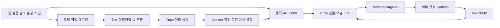

# 현재 구현과 검증 현황

**2026-10-27 NPC 발화 조명 자동 재생 제거:** `ExperienceCues.PollVoice`에서 말하기 시작·종료의 조명 Feel 재생을 없앴다.
발화 상태가 바뀌면 기존 두 플레이어를 멈추고 `personaLight`의 밝기를0으로 설정한 뒤 비활성화한다.
기존 씬의 Feel 참조와 시험용 ContextMenu는 남아 있으며 일반 대화에서 자동으로 켜지지 않는다.
가장자리 전달·대기 신호, 시작·종료 페이드와 운영자 상태 표시는 유지한다.
사용자의 최소 검증 요청에 따라 Unity C# 컴파일 오류0개와 자동 재생 경로 제거만 확인했다. 실제 재생·HMD 검사는 별도다.

**2026-10-26 시작 씬 전환 후 PC 미리보기 비율:** `OperatorHUD`의 PC 미리보기를16:9로 고정했다.
기존에는 VR 한쪽 눈 또는 원본 카메라의 비율을 그대로 사용해 카페 진입 후 거의 정사각형으로 표시될 수 있었다.
별도 미리보기 카메라는1280×720으로 출력하며 UI도 같은 비율을 유지한다. 원본 VR 카메라의 출력 대상·시야각은 보존한다.
실제 시작 버튼의 `StartScene → Scene_2` 전환에서 정사각형 입력을 통제 재현하고 수정 후 출력·투영·패널 크기 변경을 확인했다.
수정 후 검사에서는 XR 활성·눈 텍스처1904×1984 상태에서도 PC 미리보기16:9를 확인했다. 실제 HMD 착용 체감 검사는 별도다.
사용자 씬2개·배경 설정·폰트 파일의 바이트 보존과 기본 검사510개 통과를 확인했다.
근거는 Git 제외 `tools/_work/operator_preview_aspect_20261026/`와
`tools/_work/checks/20261026T142919Z-dialogue-210c1a9a/report.json`이다.

**2026-10-26 카페 재회 시연 프리셋:** 웹의 **테스트 → 친구 시연 · 카페 재회**에서 별도 가상 친구를 채운다.
생전 학교 앞 카페의 기억과 짧은 반말·감정을 먼저 받는 선호를 설문에서 LLM 추가 규칙으로 만든다.
대화3왕복·영상 약50초의 구성이고, 현재 주문·떠난 뒤 기다림·지켜봄이나 아직 말하지 않은 근황을 만들지 않도록 설정했다.
기존 할머니·친구 예시는 유지하며 선택 시 이전 사진·음성 선택을 비우고 사용자가 직접 새 등록을 진행한다.
운영 웹에 프리셋 JSON만 백업·반영했고 실제 Edge11개 확인·웹에서 만든 프롬프트의 실제 Gemma16턴을 검사했다.
시연3회9턴에서는 추가 질문이 없고 마지막 말에 짧게 동의했다. 실제 음성·HMD·40초 대화 실측은 별도다.
전체 기본 검사는583개 통과·건너뜀0개다: `tools/_work/checks/20261026T050936Z-all-4c084d39/report.json`.
설문·말투 변환기와 공통 LLM 규칙은 유지한다. [구성·사용·검사 근거](친구_카페_재회_감성_시나리오_20261026.md)를 따른다.

**2026-10-26 현재 니트 몸체 연결 확인:** 서버의 현재 완성 모델과 로컬 시험 연결 대상이 일치함을 확인했다.
Scene_2 실제 Play에서 니트 몸체 로드·52개 본 매핑·유효 Humanoid와 입장 후 착석을 확인했다.
이 검사는 새 등록이나 모델 재생성을 수행하지 않았다. 사진을 포함한 새 등록으로 완성 모델이 바뀌면 로컬 시험이 해제되고
서버 모델을 사용하므로 같은 니트 몸체를 쓰려면 새 얼굴과의 조합·연결을 다시 준비해야 한다.
근거는 Git 제외 `tools/_work/body_link_check_20261026/result.json`이며 실제 HMD 검사는 포함하지 않는다.

**2026-10-26 이동 중 인사·착석1.5배:** Scene_2의 인사는 지정 위치부터 걷기 위에 오른팔·손가락만 겹친다.
중간 정지·전신 인사·재출발 전환을 없애고 의자 방향으로 돌 때 팔을 부드럽게 내린다.
골반·다리·몸통·왼팔과 기존 시선 제어를 유지한다. 기존 앉기 클립은1.5배로 약2.067초에 재생한다.
`이동 경로 편집`의 `이동하며 한 손 인사`로 전환하며 마지막 지점 인사는 서서 한다.
같은 몸체·복제 경로의 Editor Play에서 이동 중 인사·착석·제스처 복귀·재시작·경계 조건을 확인했고 전체 모의 검사583개를 통과했다.
사용자가 현재 동작을 확인해 좋다는 피드백을 줬으며 최종 C# 컴파일 오류는0개다.
HMD 체감·전체 카페 충돌·빌드는 별도다. [동작 기록](머리_목_결합_수정_20261024.md#이동-중-한-손-인사착석15배--2026-10-26)을 따른다.

**2026-10-26 사용자 선택 걷기·인사 적용:** Mixamo에서 내려받은 `Standard Walk` 1.167초 반복과
`Waving` 4.733초를 독립 Humanoid 클립으로 분리해 Scene_2에 연결했다.
후속 요청으로 손을 흔드는 구간의 오른팔·손목6개 곡선을 조정해 좌우 이동 폭을 약 절반으로 줄였다.
소스 FBX의 스킨 바인드 T포즈로 Avatar 기준을 맞추고 이동 속도를1.25m/s로 조정했다.
이 클립 교체 단계에서는 앉기1.3배·좌석 위치·시선·목 내부 보정을 유지했으며, 이후 배속은 위의1.5배로 변경했다.
현재 몸체와 복제 경로·의자를 사용한 Editor Play에서 입장·인사·걷기 재개·착석·대화 제스처·재시작을 확인했다.
실제 HMD 외관과 발 접촉 오차는 추가 확인 대상이다. [적용·검사 기록](머리_목_결합_수정_20261024.md#사용자-선택-mixamo-걷기인사-적용--2026-10-26)을 따른다.

**2026-10-26 착석 순간 멈춤·VR 잔무늬 보완:** 착석 입력을 열 때 `Microphone.Start`가 약1.01초 막히는 것을
실제 로컬 마이크3회로 재현했다. 마이크는 체험 시작 직후 입장 전에 준비하고, 착석 때는 현재 링 버퍼 위치부터 송신한다.
입장 중 소리는 전송하지 않는다. 같은3회에서 착석 입력 전환은0.02ms 미만이며, 장치 초기화 시간 자체는 입장 전 시작 구간에 남는다.
현재 PC의 Ultra 품질에 MSAA4배, 나뭇잎·바닥9개 텍스처에 Trilinear·Aniso8,
평면 반사에 Trilinear·밉맵, VR 카메라3개에 디더링 끔을 적용했다. 렌더 배율은1이다.
실제 XR 활성 상태의 설정·눈 텍스처1904×1984를 확인했으나, 개선된 HMD 체감·프레임 여유는 미확인이다.
통제 반사6개 구도·GPU 밉 생성·해제, 시작·종료3회·페이드5회 및 전체 모의 검사583개를 통과했다.
기존 실씬 반사 검사는 수정 전 코드와 동일한6.65px 오차가 남는다. [검사 범위·제한](머리_목_결합_수정_20261024.md#착석-마이크-초기화-지연vr-잔무늬--2026-10-26)을 따른다.

**2026-10-26 눈높이·시선 분산 후속 조정:** 사용자가 실제 VR에서 머리 위를 바라보는 현상을 확인했다.
Scene_2의 `seatedHeadLiftDeg`를15도에서0도로 바꿔 추적 뒤에 덧붙던 고개 들기를 제거했고,
사용자 요청으로 `gazeBreaks`를 껐다. 좌우55도·상하35도 제한과 기본 시선 추적·호흡·듣기 반응은 유지한다.
동일 Editor 검사에서 눈높이 목표의 기준 대비 머리 방향이 약16.40도에서1.43도로 낮아졌다.
이 측정은 실제 눈 축이나 HMD 체감 검증과 구분하며 [후속 기록](머리_목_결합_수정_20261024.md#눈높이-보정시선-분산-해제--2026-10-26)을 따른다.

**2026-10-26 Scene_2 상하 시선 범위 완화:** 사용자의 실제 VR 피드백에 따라 `PersonaSpawner.gazeMaxPitch`를
22도에서35도로 넓혔다. 이 단계에서는 좌우55도·착석 고개 들기15도·반응 속도를 유지했고, 이후 고개 들기는 위의0도로 변경했다.
같은 로컬 몸체의 정상 Editor Play에서 상하30도 추적·35도 제한·좌우 추적·중앙 복귀8개 구도를 확인했다.
새35도 설정의 실제 HMD 체감은 추가 확인 대상이며 [시선 조정 기록](머리_목_결합_수정_20261024.md#상하-시선-범위-완화--2026-10-26)을 따른다.

**2026-10-25 서버 대화·LLM 전체 점검:** 기본 회귀583개, 실제 일반/추론·끼어들기 판정68개,
기억60턴·9조건과 자동 기억5개 시나리오·199턴을 통과했다. 한국어 합성 녹음의 STT→LLM→VoxCPM2 왕복·취소·복구도 확인했다.
재회 대화171턴은 생성 오류0개였으나, 떠난 뒤 기다림을 말한4건·제공된 생전 습관을 활용하지 못한3건의 품질 개선 대상이 남았다.
검사기의 가짜 감지기 종료 오류만 수정하고 회귀1건을 추가했다. 운영 서버·모델·프롬프트 v3와 등록 자료는 유지했다.
최종 서버는 `ready`, 운영 연결0개, 임시 텍스트 포트는 닫혔다. 실제 마이크·VR·청취 품질은 별도다.
[전체 점검 결과와 초기 실패·재검사 해석](LLM_전체점검_20261025.md)을 따른다.

**2026-10-25 착석 배속·인사 손목·목 안쪽 후속 수정:** Scene_2의 앉기 클립은1.3배로 재생해 약2.385초에 마친다.
인사 진입의 오른손목2축·아래팔 비틀림을 완만하게 연결했다. 착석 후 시선 움직임은 유지하며,
열린 목 윗면과 생성 머리 아래에 남은 어두운 내부 면을 인접 목 피부색으로 채운다.
설정은 `PersonaArrival.sitDownPlaybackSpeed`와 `PersonaSpawner.fillNeckInterior`다.
최종 Editor 연출379개 연속 시점·목7방향 검사와 기본 검사582개 통과·건너뜀0개를 확인했다.
기본 검사 결과는 `tools/_work/checks/20261025T060117Z-all-535424f2/report.json`이며 실제 HMD·플레이어 빌드는 별도다.
원본 모델·리그·서버 자료는 보존하며 [후속 기록](머리_목_결합_수정_20261024.md#착석-배속인사-진입-손목목-내부-피부색--2026-10-25)에 구현·검사 범위를 기록한다.

**2026-10-25 걷기·인사 후속 교체:** 사용자 재확인 후 걷기는 Quaternius `NaturalWalk` 1.333초 반복,
인사는 Mesh2Motion `NaturalGreeting` 4.8초로 교체했다. 새 보폭에 맞춰 이동 속도를0.8m/s로 조정했다.
착석 몸동작은 유지하고, 앉기 클립의 실제 혼합 비중만큼 목·머리 상대 회전을 고정해 고개 흔들림을 억제한다.
착석 뒤에는 기존 시선·듣기 반응을 쓴다. 운영 UI는 **빨간 준비 경고 → 체험 시작 → 대화 초기화** 순서다.
새 출처·검사·남은 HMD 범위는 [후속 동작 기록](머리_목_결합_수정_20261024.md#걷기인사-재교체-및-착석-머리-안정화--2026-10-25)을 따른다.

**2026-10-25 중간 동작 선택 기록:** 당시 서서 대기·걷기는 Unity 샘플 계열로,
인사는 팔을 올렸다 내리는 3.7초 동작으로 바꿨다. 좌우 회전을 구분하며 3.1초 착석 클립과 6초의 작은 앉은 대화 제스처를 연결했다.
기존 앉은 대기·듣기 끄덕임 설정·답변별 제스처 선택 정책은 유지한다. 착석 발 보정은 기본 앉은 자세의 실제 혼합 비중을 따른다.
같은 로컬 몸체·카페 경로·복제 의자로 Editor Play의 전체 전환·제스처 종료·다시 시작·우회전 선택을 확인했다.
클립 구성·검사 근거·HMD 미검증 범위는 [나머지 동작 기록](머리_목_결합_수정_20261024.md#나머지-동작-점검교체--2026-10-25)을 따른다.

**2026-10-25 보행 보정 재수정:** 발 높이에 따라 골반을 움직이던 보정과, 이후 추가한 골반6cm 하강·보행 다리 IK를 제거했다.
후자의 방식도 무릎을 과하게 굽히는 회귀가 있어 폐기했다. `PersonaSeatedFootPlacement`는 착석한 양발만 보정한다.
당시에는 Unity 공식 샘플 `UnityMaleWalk/WalkForwards`·`walkSpeed=1.46`을 사용했다. 현재 클립·속도는 위의 후속 선택을 따른다.
걷기 전환에서 이전 슬롯의 자세를 유지한 채 혼합하는 처리는 계속 사용한다.
같은 몸체·카페 경로의 실제 Play에서 기존 `Walking`과 비교하고 보폭에 맞는 이동 속도까지 확인했다.
클립 원래 자세·보정 자세의 비교와 실제 Play 검사 범위는 [원인·검사 기록](머리_목_결합_수정_20261024.md#보행-골반-진동전환-끊김-수정--2026-10-25)을 따른다.

**2026-10-25 문서 정리 — 10월24일 후속 구현·검사 기준:** 별도 준비 확인 버튼을 제거하고 **체험 시작**으로 재확인을 통합했다.
미준비 상태의 클릭에 빨간 미완료 항목을 표시하며, 실제 시작은 등록·서버·마이크·모델 준비 조건을 따른다. 안내는10월25일 후속 배치에서 버튼 위로 옮겼다.
푸른 테이블 받침은 기본 환경 반사를 `Custom` + 기존 실내 큐브맵으로 바꿔 수정했다. 배경3종 전환에서도 유지하며 금속 맵·배치·창 유리 값은 보존했다.
로컬 Play에서 시작·종료3회·페이드5회와 시작 화면의 배경3종 전환을 확인했고, 환경 반사 색은 별도 Editor 촬영으로 확인했다.
이 단계의 전체 기본 검사는 **582개 통과·건너뜀0개**이며 결과는 `tools/_work/checks/20261024T145501Z-all-d21421c1/report.json`이다.
이번 정리에서 기존 검사를 다시 실행하거나 서버를 재가동하지 않았다. 실제 마이크·HMD·플레이어 빌드 확인은 기존 미검증 범위로 남는다.

**2026-10-24 hj 시작 화면 통합:** `StartScene`에서 배경3종을 고르고 카페로 이동한다.
등록·서버·마이크·모델 준비 조건을 통과하면 한 번 자동 시작하며, 착석 후 새 입력·0.8초 종료 페이드를 유지한다.
운영자 테마는 씬 전환 뒤에도 적용하고 기존 준비 안내·버튼 연결을 보존한다. 사용자 최신 착석 위치·체형과 새 몸체 로컬 시험도 유지한다.
기존 Scene_1·Scene_2를 유지하며 빌드 첫 씬에 StartScene을 추가했다. `PlayerArrival` 초안은 미연결 상태다.
통합 근거·로컬 검사·HMD/빌드 검증 범위는 [hj 병합 기록](hj_병합_20261024.md)을 따른다.

**2026-10-24 간단한 종료 페이드:** 일반 종료는 입력·음성을 즉시 닫고0.8초 동안 화면을 어둡게 한 뒤 인물을 숨긴다.
인사말·마무리 동작·추가 대기는 없으며, 종료 중 재시작을 막고 다음 시작 때 검은 화면에서 밝아진다.
설정·검사 범위는 [체험 시작 준비·종료 페이드](체험_시작_준비_20261024.md)를 따른다.
로컬 Play에서 시작·종료3회와 페이드5회를 통과했다. 전체 기본 검사도582개 통과·건너뜀0개다.
종료 페이드 도입 당시 결과는 `tools/_work/checks/20261024T064732Z-all-25ae21ce/report.json`이며 HMD 검사는 별도로 남아 있다.

**2026-10-24 체험 시작 준비 연결:** Scene_2 시작 전에 등록·대화 서버·마이크 장치·모델과 입장 준비를 확인한다.
입장 중에는 음성 연결을 준비하고, 착석과 음성 연결이 끝난 뒤 새 마이크 입력을 시작한다.
운영자 화면의 **체험 시작**에 준비 재확인을 통합했다. 미준비 상태에서 누르면 빨간 미완료 항목을 표시한다. 현재 안내 위치는 시작 버튼 위다.
별도 확인 버튼은 제거했으며, 체험 중에는 같은 버튼으로 종료하고 마이크 선택을 잠근다.
로컬 모의 서버와 실제 모델의 임시 Play 검사에서 준비 실패·재시도·입력 차단·시작 종료3회·PCM 전달을 확인했다.
기본 검사582개 통과·건너뜀0개: `tools/_work/checks/20261024T055218Z-all-b74ec596/report.json`.
설정·검사·실제 마이크/HMD 검증 범위는 [시작 준비](체험_시작_준비_20261024.md)를 따른다. 이 단계의 프로젝트 메뉴는57개였다.
이후 몸체 시험·hj 시작 화면 통합을 포함한 현재63개 메뉴는 [Unity 도구 사용법](Unity_도구_사용법.md)을 따른다.

**2026-10-23 Unity 메뉴 정리:** 프로젝트 전용 메뉴를 **Tools > 다시봄**으로 통합하고74개에서54개로 줄였다.
`캐릭터 / 그래픽 / 대화·서버 / 개발 도구`로 구분하며, NPC 경로는 **캐릭터 > 이동 경로 편집**에서 연다.
중복 창 바로가기와 구형 COZY 시간 고정·Humanoid Probe 구성·전신 Tripo 비교 실험을 제거했다.
기능별 위치·제거 이유·검증은 [Unity 도구 사용법](Unity_도구_사용법.md)을 따른다.
메뉴 정리 후 전체 기본 검사는 **582개 통과·건너뜀0개**이며,
메뉴 정리 단계의 결과는 `tools/_work/checks/20261023T071740Z-all-1199d851/report.json`이다.
메뉴 등록54개·옛 경로0개, 새 경로의 창·테스트 씬 열기와 기존 설정244개 파일의 보존을 확인했다.

**같은 날 얼굴·몸체 체형 미리보기 추가:** `Tools > 다시봄 > 캐릭터 > 얼굴·몸체 비율 조절 씬 열기`로
`Persona_BodyShape_Preview`를 연다. 결합 모델을 가져와 Play 없이 체형6개 키, 전체 크기·머리 크기/높이/앞뒤를 조절한다.
기본 T포즈의 양손을 대칭으로 편다. 10월24일 옷깃 복원·머리 전체 이동으로 목 결합을 다시 고쳤다.
얼굴을 늘리던 처리와 덧댄 목 원통·피부색 재질은 제거했다. [머리·목 결합 보정](머리_목_결합_수정_20261024.md)을 따른다.
미리보기 값은 별도 자산에 저장하고 **기본 체형에 적용**을 눌러야 공용 기본값으로 복사한다.
**10월24일 카페 비교 추가:** 같은 조절창에서 실제 `Scene_2`와 단독 배경을 전환한다. 두 모드에 카페의 키 정규화·추가 배율을 적용하고,
실제 의자와 체험자 자리에서 비교한다. HMD 착용 전에는 바닥 기준 미리보기 눈높이(기본1.2m)를 사용하며 자세별 높이도 cm로 표시한다.
크기 변경 중 시점 고정·바닥 보정·배경 왕복·사용자 설정/Scene_2 보존을 검사했다. 실제 HMD 추적 검사와 구분한다.
실제 결합 GLB의 체형36개·추가 크기24개 조합, 보호 정점·본 보존·양손 T포즈·머리 회전과 실제 UI 슬라이더 연결을 확인했다. 이 단계의 메뉴는56개였다.
모델은 로컬 캐시에만 보관하며 씬에 저장하지 않는다. 설정·한계·검사는 [체형 미리보기](얼굴_몸체_체형_미리보기_20261023.md)를 따른다.
10월24일 결합 수정 단계의 전체 기본 검사도582개 통과·건너뜀0개다. 당시 결과는 `tools/_work/checks/20261024T014542Z-all-a1a3e13a/report.json`이다.

운영 재개 기준일: **2026-10-08 23:32 KST**. 10월 3일 보관한 설정으로 프로젝트 서비스 6개를 재개했다.
서버·외부 PC의 HTTP 준비 상태와 Scene_2 Play의 등록 인물 조회·3D 모델 로딩·체험 시작 버튼 활성화를 확인했다.
최근 읽기 전용 상태 점검은 **2026-10-23 13:05:57 KST**이며 아래2장에 기록했다. 문서 갱신에서 서버를 새로 조회한 것은 아니다.
재개 명령과 보관·검사 기록은 [프로젝트 보관과 재시작](프로젝트_보관_재시작_20261003.md)을 따른다.
10월 3일에는 `hj`가 `jw`의 모든 작업을 포함함을 확인했고, 남은 애니메이션 메타데이터를 Unity에서 검증했다.
10월 3일의 원격·`main` 정리 근거는 [브랜치 최종 정리](브랜치_최종정리_20261003.md)에 있다.
기본 대화·모델 제작 경로의 통합 기준은 **2026-10-01**, `hj` 코드(`0d41f937`까지)다.
`jw`의 Scene_2 캐릭터 입장·애니메이션 변경(`b9151359`)과 `hj`의 머리 파이프라인 후속 수정이 포함돼 있다.
그 뒤의 기본 몸체·체형·출력 보정·그래픽과 캐릭터 반응·음향 변경은 아래10월12~23일 항목을 따른다.
이 문서는 현재 운영 안내의 출발점이다. 날짜가 붙은 실험 문서의 수치·한계는 당시 기록으로 읽는다.
문서 수정이나 Git 머지가 서버 배포·실제 생성·VR 체험 검증을 대신하지 않는다.
기술 흐름을 처음 읽을 때는 [프로젝트 기술 개요](프로젝트_기술_개요.md)를 함께 본다.
2026-10-07에는 사용자 요청으로 로컬 `main`의 Scene_2 배경·조명·재질을 조정했고,
10월 8일에는 실제 VR 피드백에 따라 창 유리와 창밖을 수정했고, 10월 9일에는 반사 조절 Inspector와
사용자가 조절을 마친 재질 값을 반영했다. 기존 정원 그래픽 기준은 **2026-10-09 `main`**이다.
서버 보관·재개 기준일과 그래픽 변경일을 구분한다. 아래 날짜별 그래픽 항목은 변경 이력이며,
이전 큐브맵 창 반사·잘린 수목 PNG·서로 겹친 원경 호는 최종 설정으로 사용하지 않는다.

**2026-10-12 로컬 기본 몸체 변경:** 사용자가 확인한 남성 양손을 `Assets/Models/human/Human.fbx`에 반영하고
양손 피부·손톱·노멀·거칠기와 검은 소매 안감 재질을 연결했다. 본60개와 기존 FBX GUID를 유지하고
새 손 본에 맞춰 Humanoid 기준 자세를 갱신했다. 제작 원본은 `tools/model_sources/Human_Male_Natural.blend`다.
Unity Editor에서 FBX·GLB 각각7개 실제 Humanoid 동작과 구체 머리 결합 GLB를 검사했다.
10월 13일에는 새 몸체 GLB와 다중 재질 결합 출력을 서버에 반영하고, 현재 등록 인물의 저장된 머리를
새 몸체에 재결합해 등록 API 모델을 갱신했다. 얼굴 텍스처·UV·설문·음성은 보존했고 유료 생성 호출은0회다.
Unity Scene_2 Play에서 서버 모델 다운로드·새 손/검은 안감·유효 Humanoid·등장 후 착석을 확인했다.
새 모델을 미리 받은 뒤 체험 시작의 등장 경로로 이어지며, 다른 등록 인물의 완성 모델은 자동 교체하지 않는다.
재현·검사 범위는
[몸체 수정 검토 22장](몸체_체형_수정_검토_20261011.md#22-unity-기본-몸체-반영--2026-10-12)과
[23장 서버 적용](몸체_체형_수정_검토_20261011.md#23-서버-몸체현재-캐릭터-갱신과-실제-등장--2026-10-13),
[제작 원본 안내](../tools/model_sources/README.md)에 있다.

**2026-10-13 Unity 체형 조절:** `Human_BodyShapeControls.blend`의 체형 키6개를 기본 FBX·서버 몸체와
현재 등록 캐릭터에 반영했다. **Tools > 다시봄 > 캐릭터 > 체형 조절 열기**에서 상체 폭·두께, 허리 폭,
배 볼륨, 팔·다리 굵기를−1~1로 조절한다. 0은 원래 체형이다. 설정은 `Assets/Resources/PersonaBodyShape.asset`에
저장하며 Play 종료 후에도 유지된다. 키·관절 배치·얼굴·손·신발은 고정한다. 로더의 개별 설정이 없으면
기본 설정을 새 캐릭터에도 적용한다. 등록 인물별 자동 저장이나 사진 기반 체형 추정은 구현하지 않았다.
FBX·GLB 체형/포즈40개 조합·기존14개 동작, 실제 서버 모델의 체형 조절과 등장·착석을 확인했다.
현재 등록 모델만 재결합했으며 다른 기존 인물은 자동 갱신하지 않는다. 실제 HMD·플레이어 빌드 검사는 별도다.
사용법·검사·서버 백업은 [몸체 수정 검토 25장](몸체_체형_수정_검토_20261011.md#25-unity-inspector-체형-조절과-현재-캐릭터-반영--2026-10-13)을 따른다.

**2026-10-22 로컬 하늘 카페 시안:** 사용자 참고 이미지의 남색 하늘·푸른 달빛 구름·별·초승달 분위기를
Scene_2에 적용했다. 실내에서 흐릿하고 평면적으로 보인다는 피드백에 따라 파노라마·카드를
방향 기반 하늘 셰이더와3D 밀도를 레이마칭하는 구름9개로 교체했다. 세부 명암은 구름 이미지에서 투영한다.
사용자가 확인한 밤 버전의 재질·배치를 보존하고, 푸른 하늘·흰색·연보라·분홍빛의 파스텔 버전을 별도로 추가했다.
현재 파스텔 버전을 켰다. 테라스·난간·부유암은3D이며 카페 내부와 유리 재질·테이블·담장 배치를 보존했다.
**Tools > 다시봄 > 그래픽 > 배경 선택**에서 **밤하늘 카페 / 파스텔 하늘 카페 / 기존 정원**을 고른다.
같은 날 완료된 수정·전후 촬영 메뉴를 정리해34개를10개로 줄이고, 반사 조절·검사·베이크는 **기능** 아래로 묶었다.
배경 선택3개의 사전 비활성 조건은 제거했으며, 다른 씬·Play·베이크 중에는 클릭 시 이유를 안내한다.
추가로 수정된 `Scene_2/LightingData.asset`·라이트맵·반사 프로브0~5의 저장 결과도 함께 보존한다.
세 배경은 현재 같은 씬의 조명 데이터를 공유하며, 배경 선택만으로 베이크 데이터를 교체하거나 새로 굽지는 않는다.
Editor 구도·컴파일·씬 검사·전환 복원과 고정/이동 카메라의 구름 변화는 확인했다.
실제 HMD·성능·플레이어 빌드는 별도다.
현재는 사용자 검토를 위한 로컬 시안이다. 사용법·표현 방식·이미지 프롬프트·검사 범위는
[하늘 카페 시안](Scene2_하늘_카페_20261022.md)을 따른다.

**2026-10-22 커밋 전 로컬 검사:** Unity2022.3.62f2의 Scene_2 씬 검사 문제0, 새 C#·셰이더 오류0을 확인했다.
밤하늘·기존 정원·파스텔 메뉴를 실제 실행했고, 보호 구성·유리 재질·파스텔로 복원한 씬 파일이 일치했다.
`python tools/check.py --area all --python tools/_work/check_env_20260913/Scripts/python.exe`는
하네스207·서버302·제작 작업자16·웹57, **총582개 통과·건너뜀0**이다.
보고서: `tools/_work/checks/20261021T224629Z-all-ad1864b9/report.json`.
10월22일 정리에는10월12~13일의 몸체·체형 코드/제작 원본과 배경·메뉴·저장된 조명 데이터를 함께 포함했다.
이 검사는 새 서버 배포·모델 생성·HMD·플레이어 빌드 검증을 뜻하지 않는다.

**2026-10-23 캐릭터 듣기 반응·공간 음향:** 사용자 요청으로 Scene_2의 자동 듣기 반응을 켜고,
확정 발화에 작은 절차적 끄덕임을 연결했다. 최소 발화 길이1.2초·최대4.5도·0.9초·간격4.5~7초이며,
자막 숨김 상태와 같은 프레임의 발화 시작/종료 신호에서도 같은 입력에 한 번만 반응한다.
시선·호흡·15도 착석 보정·기존 말하기 제스처를 유지한다.
새 PersonaVoiceSpatialAudio가 목소리를 머리에 따라 붙이고, 기존 Meta XR Audio를 PCM 필터 뒤에 적용한다.
모델이 없는 음성 전용 체험은2D로 돌아간다. 음량·믹서·음성 재생 커서·등록 음성은 변경하지 않았다.
합성 대화 신호·공통 Humanoid·최종 스테레오 PCM 출력과 기존 리샘플러38·보류 경계28개 검사를 통과했다.
해당 기능 구현 직후 전체 기본 검사도582개 통과·건너뜀0이며 결과는 `tools/_work/checks/20261023T065601Z-all-85d20026/report.json`이다.
자세한 결과와 남은 실제 HMD 청취·등록 목소리 왕복 범위는
[듣기 반응·공간 음향](캐릭터_듣기_반응_공간음향_20261023.md)을 따른다.

## 1. 현재 두 경로

| 영역 | 현재 구현 | 운영·사용 문서 |
|---|---|---|
| 등록 웹 | 설문 v2, 단일 화자 참조 파일, 선택 사진, `/publish_direct`, 서버 발급 UUID4 | [웹 사용법](../Web/README.md), [설문 v2](웹_설문_v2_사용법.md) |
| 3D 제작 | 머리 생성 후 고정 몸체와 결합. 리그 보존·클립 미포함 GLB, 동작은 Unity에서 연결 | [머리 생성 파이프라인](Tripo_머리_생성_파이프라인.md) |
| STT·입력 판정 | Whisper large-v3 CUDA/float16, VAD, 음성 감정 분류 없음 | [Whisper 전환](Whisper_STT_전환.md) |
| 대화 | Gemma 4 31B QAT, 일반/추론 thinking 설정, `semantic_v1`, 연결별 기억 | [서버 구조](서버_음성대화_구조.md) |
| 음성 출력 | VoxCPM2, `reference_audio`, `generation_pcm`, Unity에는 24kHz 모노 PCM16 | [TTS 인계](TTS_작업인계_20260918.md) |
| Unity | 2022.3.62f2, 대화 `AI_Response_Test`, 기존 전신 모델 `Tripo_Model_Test`, 등록 체험 `Scene_2` | [AI 씬](AI_응답_테스트_씬.md), [모델 검사](Tripo_모델_테스트_씬.md) |

사진을 선택하는 것만으로 생성하지 않는다. 설문·참조 음성·인물 확인을 마치고 **세션 시작**을 누르면
사진이 있는 등록을 모델 작업으로 접수한다. 사진이 없으면 인물만 등록한다.
음성·설문 없이 사진만 받는 독립 `/tripo/jobs` 제작 웹은 아직 설계안이다.

### Scene_2 그래픽 현재 설정

2026-10-09 `main` 기준이다. 수목 기하는 `21aa7521`, 사용자 정원 배치는 `d277f4b3`에 반영했고,
아래 창 반사 값은 10월 9일 사용자가 조절을 마친 재질 파일과 Unity Editor에서 대조했다.
전국 대회 발표는 시연 영상이며 완성 목표는 **10월 27일**이다.

| 대상 | 최종 설정 |
|---|---|
| 정면 큰 창 | `WindowGlass` 평면 반사. 정면 0.189·비스듬한 0.035·밝기 0.6·밝은 반사 완화 0·유리 색 알파 0.003. 사용자 최종 조절값 |
| 왼쪽 타원 창 2곳 | `OvalWindowGlass` 평면 반사. 정면 0.807·비스듬한 0.877·밝기 0.835·밝은 반사 완화 0.726·유리 색 알파 0.003. 복제 벽의 실제 두 개구부로 외부 투과 |
| 열린 문 | `ClearDoorGlass`, 알파 0.01. 다른 평면인 앞 창의 반사 화면을 공유하지 않음 |
| 반사 렌더링 | 앞·왼쪽의 두 평면, 좌우 눈의 행렬·텍스처 분리, 눈별 512 해상도. 굴절·화각 확대 없음 |
| 창밖 근경·하늘 | 앞·옆의 3D 포장·담장·화단·소품, Unity Procedural Skybox |
| 먼 수목 | `DistantTreesComplete.png`. 같은 반경 30m의 연속 120도 호 3개, 수목판 높이 10m, 가로 Repeat·세로 Clamp, 연결된 UV. 밑동의 실제 픽셀을 y=0.0004 지면에 정렬 |
| 조명 데이터 | 라이트맵 1개·프로브 1691개. 수목 변경에는 기존 간접광을 유지하고 실내 반사 프로브를 다시 베이크 |
| 실내 기본 환경 반사 | 10월24일 푸른 금속 받침 수정: `Custom` + 기존 `Assets/Graphics/Scene2/CafeInteriorReflection.exr`. 반사 강도0.8과 테이블 원본 금속 맵을 유지 |
| 수동 씬 수정 | 사용자가 옮긴 테이블과 담장을 보존. 10월 9일 현재 씬의 추가 위치 조절도 함께 반영하며 대화 컴포넌트·접속 설정은 기존 기록과 동일 |

10월24일 테이블 받침이 푸른색으로 보이는 문제는 기본 하늘 반사 입력을 기존 실내 큐브맵으로 바꿔 수정했다.
실내 프로브가 채우지 못하는 반사는 하늘 환경으로 보충되는 [URP 14의 동작](https://docs.unity3d.com/Packages/com.unity.render-pipelines.universal@14.0/manual/lighting/reflection-probes.html)을 따른다.
테이블 셰이더·금속 맵·배치, 창 유리 재질·평면 반사 설정, 몸체·체형·착석 위치는 변경하지 않았다.
자연광 재구성·실내 반사 베이크에도 같은 기본 반사를 연결하도록 유지했다. 해당 전체 구성 도구를 이번 수정 과정에서 실행하지는 않았다.
Editor 촬영에서 밤하늘·파스텔·정원3종의 반사 유지와 받침 색을 확인했고 저장된 씬으로 복귀했다.
결과는 Git 제외 `tools/_work/cafe_reflection_fix/background_validation.json`과 `fixed_*.png`다. 실제 HMD 양안 검사는 포함하지 않았다.
Unity 재컴파일 후 C# 오류는 관측되지 않았고 기본 검사582개 통과·건너뜀0개를 확인했다.
전체 검사 결과는 `tools/_work/checks/20261024T145501Z-all-d21421c1/report.json`이다.

`Assets/Scenes/Scene_2.unity`를 **Edit Mode**로 열고 `Tools > 다시봄 > 그래픽`에서 필요한 부분만 실행한다.

| 필요한 작업 | 메뉴·후속 작업 |
|---|---|
| 배경 전환 | `배경 선택 > 밤하늘 카페 / 파스텔 하늘 카페 / 기존 정원` |
| Inspector에서 창 반사 강도 조절 | `기능 > 유리 반사 조절 열기` → 창별 조절 → `반사 설정 저장` |
| 실내 구도 보기 | `기능 > 창가에서 보기` |
| 배경 촬영·검사 | `기능 > 검사 > 현재 배경 촬영·검사 / 배경 전환 보존 검사` |
| 창 반사 검사 | `기능 > 검사 > 유리 반사 검사` |
| 조명·반사 갱신 | `기능 > 베이크 > 실내 조명` 완료 후 필요에 따라 `실내 반사·저장` |

2026-10-09에는 `CafePlanarReflection`의 전용 Inspector를 추가했다.
`Tools > 다시봄 > 그래픽 > 기능 > 유리 반사 조절 열기`가 `05_조명과 날씨/창과 거울의 평면 반사`를 선택하고
같은 Inspector 내용을 표시하는 반사 조절 창을 연다. 기존 Inspector가 다른 오브젝트에 잠겨 있어도 조절 화면을 열 수 있다.
Inspector에서 **정면 반사·비스듬한 반사·반사 밝기·밝은 반사 완화**를 창 종류별로 조절한다.
값은 연결된 유리 재질에서 읽으며 Inspector를 열기만 해서는 현재 설정을 덮어쓰지 않는다.
변경은 즉시 적용되고 Undo/Redo를 지원한다. `반사 설정 저장`은 해당 유리 재질만 저장하며 Play 중 조절도 가능하다.
예전 `평면 반사 적용`·`창 유리 반사 수정` 등 초기 설정 메뉴와 전후 비교 촬영 메뉴는10월22일 제거했다.
이하 날짜별 항목에 등장하는 옛 메뉴 이름은 당시 작업 기록이다. 현재 조작 경로는 위 표를 따른다.
구현은 `Assets/Editor/CafePlanarReflectionEditor.cs`·`CafeGlassReflectionWindow.cs`이며 반사 런타임·셰이더·씬 연결은 변경하지 않는다.

네 가지 재질 설정의 범위는 모두 **0~1**이다.

| Inspector 설정 | 셰이더 속성 | 의미 |
|---|---|---|
| 정면 반사 | `_ReflectionOpacity` | 유리를 똑바로 볼 때의 반사 강도. 높이면 실내 반사가 진해지고 바깥 투과가 줄어듦 |
| 비스듬한 반사 | `_GrazingOpacity` | 옆으로 비껴 볼 때의 반사 강도. 시선 각도에 따라 정면 값에서 이 값으로 변화하며 정면보다 작게 설정할 수도 있음 |
| 반사 밝기 | `_ReflectionGain` | 반사된 풍경의 밝기. 반사·투과를 섞는 비율은 바꾸지 않음 |
| 밝은 반사 완화 | `_HighlightCompression` | 높은 값일수록 간판·조명처럼 밝은 반사를 더 눌러 눈부심을 줄임 |

고급 설정의 **반사 갱신 간격**은 1~3프레임, **반사 경계 보정**은 유리 평면의 클리핑 오프셋이다.
**반사 표면 연결**은 창 렌더러·평면·눈별 해상도를 연결한다. 현재 눈별 해상도는 512이며 일반 강도 조절에 이 연결을 바꿀 필요는 없다.

원경 이미지는 [수목 제작·밑동 정렬 기록](Scene2_수목_이미지_제작.md)을 따른다.
이전에 로컬에 남겨 둔 `Scene_2.unity` 배치 변경도 사용자 전체 커밋 요청으로 `main`에 반영했다.
다른 clone에서는 최신 `main`을 받은 뒤 Scene_2를 열어 현재 배치를 확인한다.

최신 모의 검사 기록은 **509개 통과·건너뜀 0개**(하네스 207·서버 302),
`tools/_work/checks/20261008T155007Z-dialogue-216aaaa1/report.json`이다(10월 9일 00:50 KST).
수목 수정 전후 13개 구도와 재질 62개 지원, 씬 검사 및 기존 씬 기록 보존을 확인했다.
비교 화면은 `tools/_work/graphics_20261008_rework/roots_comparison.html`이다.
반사 Inspector의 8개 조절 항목·숫자 입력·저장 버튼은 Unity 화면에서 확인했다.
기록은 `tools/_work/glass_inspector_20261009/validation.json`·`inspector.png`다.
최종 재질 대조 시 Scene_2는 저장된 Edit Mode였고, 씬 검사에서 누락 스크립트·깨진 프리팹·전체 문제는 모두 0개다.
프로젝트 C# 오류는 관측하지 않았으며 기존 MCP 연결 종료 로그 2개는 남아 있다.
`tools/_work/`는 Git 제외 자료이며 새 clone에는 없다. 촬영 PNG·검사 보고서를 Git에 포함했다고 설명하지 않는다.

사용자의 왜곡 개선·정면 큰 창 승인과 개발자의 Editor 검사를 구분한다.
최종 HMD의 양안 표시·움직임·프레임 시간, 플레이어 빌드와 시연 영상 확인은 남아 있다.
10월 9일 최종 설정 저장·문서 최신화에서는 재질 값·Unity Editor 상태·메뉴·씬과 기존 검사 기록을 대조했다.
같은 기본 검사는 반복하지 않았고 새 Play·음성 왕복·HMD 성능·플레이어 빌드·유료 생성은 실행하지 않았다.

### 9월 30일 Scene_2 작업 정리

- 하이라이키를 역할별로 묶고 시험용 Human을 정리했다. 현재 인물은 서버 모델을 로드해 사용한다.
- 고정 Human 몸체의 본과 손가락을 Humanoid에 연결하고, 팔 기준 자세와 발목 보정을 적용했다.
- `체험 시작`으로 모델 표시와 입장 연출을 시작한다. 종료하면 숨기고, 같은 인물로 다시 시작할 수 있다.
- `Idle → Catwalk → Waving → Catwalk → 방향 정렬 → Sitting Idle`로 연결한다.
  이동 경로와 인사 위치는 `Tools > 다시봄 > 캐릭터 > 이동 경로 편집`에서 직접 지정한다.
- NPC 답변에서 Sitting Talking을 평균 25%로 선택하되 연속 답변에는 선택하지 않는다.
- 이동·정지·인사 동안 캐릭터 높이는 고정한다. 몸 전체가 위아래로 튀던 바닥 자동 추종은 제거했다.
- `Scale Multiplier`는 몸체·얼굴 전체 배율, `Seated Head Lift Deg`는 앉은 고개 보정이다.
  Scene_2의 현재 값은 각각 1.2와 15도다. Play 중 리깅은 `Tools > 다시봄 > 캐릭터 > 전체 리깅 보기`에서 확인한다.

코드·메뉴·설정과 단계별 검사는 [머리 파이프라인 7장](Tripo_머리_생성_파이프라인.md#7-고정-몸체의-애니메이션-연결--2026-09-30)을 따른다.

### 10월 7일 Scene_2 자연광·재질 개선

- 전국 대회 시연 영상을 위해 배경을 자연스러운 낮의 카페로 조정했다. COZY 날씨 오브젝트는 비활성화하고
  기존 카페 패키지의 HDR 하늘을 Scene_2 전용 재질로 복제했다. 원본 날씨 프로필·판매자 재질은 보존했다.
- 창가의 5500K Mixed 광원과 3400K 실내 조명을 구성했다. 고정된 실내 조명 16개는 Baked로 전환했고
  CPU Progressive 베이크로 간접광을 저장했다. 현재 라이트맵은 1개이며 캐릭터 동선에 프로브 140개를 추가했다.
- 목재·바닥·식물·포장재 등의 광택을 낮추고, 유리는 URP Lit의 Alpha + Preserve Specular 블렌딩으로
  투과와 반사를 분리했다. 조정한 재질 17개는 `Assets/Graphics/Scene2/Materials/`에 있고 Scene_2에서만 사용한다.
- 실내 반사 프로브를 추가하고 기존 고해상도 프로브는 256으로 줄여 다시 베이크했다.
  당시 왼쪽 타원형 표면은 정적 큐브맵 거울이었다. 10월 8일에는 실제 개구부와 평면 반사가 있는 창으로 전환했다.
- VR 카메라에 Neutral 톤매핑·약한 색 보정과 Bloom을 연결했다. 눈높이·리그·캐릭터 경로는 변경하지 않았다.
  인물 모델, 대화 설정, 음성에 반응하는 인물 빛과 서버 운영 상태는 보존했다.
- 조명 데이터는 `Assets/Scenes/Scene_2/`, 전용 설정은 `Assets/Graphics/Scene2/`에 저장했다.
  전역 URP 품질·패키지는 변경하지 않았다.

편집 도구는 `Assets/Editor/Scene2NaturalLighting.cs`, 비교 촬영은 `Scene2GraphicsCapture.cs`다.
Unity의 `Tools > 다시봄 > 그래픽`에서 다음 순서로 사용한다.

1. `자연광·재질 적용`: Scene_2의 전용 설정을 적용하고 저장한다. 수동 재질 조정값도 이 프리셋으로 다시 맞춘다.
2. `실내 조명 베이크 시작`: 비동기로 간접광을 계산한다. 베이크가 끝난 뒤 다음 단계를 실행한다.
3. `실내 반사 베이크·저장`: 실내 큐브맵을 계산하고 씬·자산을 저장한다.
4. `변경 후 촬영·검사`: 입구·계산대·좌석의 고정 구도를 촬영한다. `완성된 카페 보기`로 Scene View도 확인할 수 있다.

촬영·검사 결과는 Git 제외 폴더 `tools/_work/graphics_20261007/`에 저장한다.
변경 전·후는 같은 위치, 눈높이 1.35m, FOV 70도, 1280×720으로 비교했다.
운영 인물 자료·대화 연결 설정·API 키는 그래픽 검사 보고서에 넣지 않는다.

### 10월 8일 Scene_2 창 유리·창밖 초기 수정

- 사용자가 VR에서 창 유리의 내부 풍경 반사 위치가 맞지 않고 너무 진하며, 창밖 바닥과 거리 분위기가
  카페에 맞지 않는다고 확인했다. 기존 유리의 `Preserve Specular`가 반사를 알파와 별개로 유지하고,
  큰 평면 창에 실내 큐브맵을 사용해 공간이 왜곡돼 보이는 설정을 수정했다.
- 출입문·앞쪽 창 유리 3곳을 진열장과 분리해 `WindowGlass.mat`을 사용한다. URP Lit Alpha,
  알파 0.03, `Preserve Specular` 꺼짐, `Environment Reflections` 꺼짐, Renderer의 반사 프로브 사용 꺼짐이다.
  창에는 굴절·왜곡 효과를 추가하지 않았고, 곡면 진열장·유리병 재질은 기존 반사를 유지한다.
- 거리 사진으로 둘러싼 하늘을 Unity 기본 Procedural Skybox로 바꿨다. 창밖 근경은
  `04_카페 배경/카페 앞 정원`의 실제 3D 바닥·담장·화단·식물·야외 테이블로 구성했다.
  공개 카페 소품과 보유 노이즈 텍스처를 재사용했으며 사진이나 새 캐릭터 모델을 생성하지 않았다.
  석재 포장의 상단은 기존 테라스와 같은 약 y=0.0004m이다. 좌우 눈 위치와 고개 이동에 따라 근경의 위치가 달라진다.
- CPU Progressive 간접광과 실내 반사를 다시 베이크했다. 라이트맵은 1개, 프로브는 1691개다.
  이 초기 수정에서 왼쪽 타원형 표면은 기존 정적 큐브맵 방식이었다. 아래 후속 작업에서 평면 반사로 대체했다.
- 사용자가 직접 바꿨다고 확인한 실내 테이블 4개의 배치를 보존했다. 기존 대화 MonoBehaviour와
  XR 설정, 캐릭터 모델·동작은 변경하지 않았다. 이 그래픽 변경 시점에는 서버 보관 상태를 유지했다.

`Scene2Courtyard.cs`가 창밖을 구성한다. `자연광·재질 적용`에도 새 하늘·마당·창 유리 설정을 연결해
재실행 시 거리 사진과 강한 창 반사가 복원되지 않게 했다. 부분 수정 메뉴는 `창 유리 반사 수정`,
`창밖 마당 적용`이고, 이후 `실내 조명 베이크 시작 → 실내 반사 베이크·저장` 순서로 다시 굽는다.

검사·촬영 결과는 Git 제외 폴더 `tools/_work/graphics_20261008/`에 저장했다.
입구·계산대·좌석과 함께 창 근처 1.55m 눈높이, 눈 간격 64mm, 고개 이동 0.5m, 서 있는 구도 1.7m를
같은 FOV 70도·1280×720으로 촬영했다. `comparison.html`에서 전후를 비교할 수 있다.
사용자 테이블 조정으로 촬영 사이의 배치도 달라졌으므로 배경·유리 비교와 배치 비교를 구분한다.

Unity Editor 컴파일·씬 검사(누락 스크립트 0, 깨진 프리팹 0)를 통과했다.
대화 하네스는 509개 통과·건너뜀 0이며 결과는
`tools/_work/checks/20261008T054230Z-dialogue-dd7967dd/report.json`이다.
수정 후 실제 HMD 렌더링·렌즈·프레임 시간, 플레이어 빌드와 캐릭터 입장 경로는 아직 검사하지 않았다.
고정 카메라·눈 위치를 옮긴 Editor 촬영을 실제 VR 재검증으로 보고하지 않는다.
소스·문서의 공백 검사는 통과했다. Unity가 생성한 씬·재질·메타의 빈 필드에서
`git diff --check` 공백 경고 130개가 남아 있으며, 이를 없애기 위해 직렬화 파일을 수동 편집하지 않았다.

### 10월 8일 후속 — 평면 반사와 타원 창의 실제 외부 시야

사용자가 말한 왜곡은 유리 자체의 굴절이 아니라 **반사 속 실내가 실제보다 넓게 보이는 현상**이었다.
초기 수정의 반사 제거만으로는 그 의도를 충족하지 못해 아래 구성으로 대체했다.
적용 도중 사용자는 왜곡이 없어졌다고 확인했다. 이후 반사가 강한 곳을 왼쪽 벽의 타원형 표면으로 특정했고,
정면의 큰 창 유리는 현재 상태가 맞다고 확인했다. 이후 타원 창에서 외부가 보이지 않는다는 피드백과
배경 끝이 드러나는 사진에 따라, 왼쪽 벽 개구부와 카페 옆·뒤 배경까지 구성했다.

- 앞 창 2곳과 왼쪽 타원 창 2곳을 실제 평면·관찰자 위치에 맞춘 실시간 반사로 전환했다.
  `CafePlanarReflection.cs`는 눈의 뷰·투영 행렬을 평면에 대칭시키고, 창 너머의 물체는 클립 평면으로 제외한다.
  앞 창과 타원 창은 서로 다른 평면 반사 텍스처를 사용한다. 굴절이나 반사 화각 확대는 사용하지 않는다.
- 창 유리 `WindowGlass`의 정면 반사 계수는 0.006, 비스듬한 각도의 최대값은 0.035, 밝기 계수는 0.6이다.
  바로 전 설정(0.02 × 0.9)에 비해 정면 반사의 선형 밝기 계수를 약 80% 낮췄다.
  유리 색 알파는 0.003이다. 열린 문은 앞 창과 다른 평면이므로 별도 `ClearDoorGlass`로 옅게 표현한다.
  곡면 진열장과 병은 기존 URP 유리 재질을 사용한다.
- 판매자 카페의 타원형 표면은 원래 막힌 벽에 붙인 `Mirror`였다. 반사 강도만 낮추면 벽이 보이므로,
  원본 FBX를 보존하고 Scene_2 전용 벽 메시를 복제해 유리 윤곽에 맞는 두 개구부를 만들었다.
  원본 UV0·UV2를 보간해 벽 질감과 조명이 삼각형 조각마다 끊기는 현상을 방지하고, 벽 두께를 잇는 면도 추가했다.
  왼쪽 유리 `OvalWindowGlass`는 정면 반사 0.075, 비스듬한 최대값 0.16, 밝기 0.8, 유리 색 알파 0.003이다.
  옅은 실내 반사를 남기면서 실제 외부가 투과된다. 밝은 반사 완화는 0.35이며 정면 큰 창의 승인된 강도는 유지한다.
- 현재 OpenXR 설정의 Single Pass Instanced에 맞춰 좌·우 눈의 반사 텍스처·행렬을 분리했다.
  어느 눈에서든 표면이 보일 때 갱신하고, 자기 표면·다른 반사 표면을 반사 렌더링에서 제외해 재귀를 막는다.
  두 평면 모두 눈당 최대 512 해상도다. 컴포넌트 비활성화·씬 종료 시 임시 카메라와 텍스처를 해제한다.
- 창밖은 낮춘 담장, 목재 그늘막과 덩굴, 벤치, 찻잔·주전자, 높이·간격이 다른 식재로 보강했다.
  왼쪽에도 포장 바닥·낮은 담장·높이가 다른 화단과 녹지를 연결했다. 가까운 바닥·식물·소품은 3D다.
  먼 수목만 이미지 생성으로 만든 알파 PNG를 앞·왼쪽·뒤쪽의 곡면 메시에 배치했다. 반경은 26·30·32m이며,
  세 호의 방향을 겹쳐 창에서 배경의 수직 끝과 빈 공간이 드러나지 않게 했다. 하늘은 Procedural Skybox,
  바닥은 기존 테라스와 높이가 이어지는 실제 포장 메시다. 원경 수목은 입체 나무 모델이 아니다.
- CPU Progressive 간접광과 실내 큐브맵을 다시 베이크했다. 큐브맵을 굽는 동안 평면 반사를 잠시 비활성화해
  이전 눈 위치의 화면이 큐브맵에 들어가지 않게 한다. 라이트맵 1개와 프로브 1691개를 유지한다.
  사용자가 옮긴 실내 테이블 4개, 기존 대화 MonoBehaviour, 캐릭터 동작과 XR 설정은 보존했다.

설정 도구는 `Scene2PlanarReflectionSetup.cs`, 개구부 도구는 `Scene2OvalWindowOpenings.cs`,
셰이더는 `CafePlanarSurface.shader`다. 복제 벽의 meta에 원본 메시의 GUID·fileID를 기록해,
개구부를 다시 적용할 때 이미 잘린 메시를 또 자르지 않는다. 원본 자산을 다시 불러와 구성한다.
`평면 반사 적용` 또는 `창 유리 반사 수정`으로 같은 창 구성을 적용한다.
`자연광·재질 적용`에도 연결해 재실행 시 이전 큐브맵 창 반사로 돌아가지 않게 했다.
`평면 반사 기하 검사`, `평면 반사 렌더링 검사`, `타원 창 외부 가시성 검사`를 별도로 제공한다.
벽 개구부·근경을 다시 적용한 경우 조명과 반사 베이크도 다시 실행한다.

검사 결과는 Git 제외 폴더 `tools/_work/graphics_20261008_rework/`에 저장한다.
두 평면·좌우 눈 위치의 기하 표본 8개, 창의 실제 반사 렌더링 표본 12개를 검사했고,
표본의 예상 위치와 렌더링 중심의 최대 차이는 약 1.09픽셀이었다.
배율·상하 방향과 비활성화 후 리소스 해제도 확인했다.
타원 창 두 곳에서 좌·우 눈 위치와 고개 이동을 바꾼 외부 가시성 검사 6개도 통과했다.
실제 벽을 포함한 화면에서 외부 표본 물체가 보였고, 원본 벽 메시로 잠시 대조하면 모두 가려졌다.
Editor 촬영에서 배경 재질 62개는 모두 지원된다. 누락 스크립트·깨진 프리팹은 0개다.
기존 씬 오브젝트 삭제·정원 밖 Transform 변경·기존 MonoBehaviour 변경은 모두 0개다.
커밋 전체의 공백 검사에는 Unity가 저장한 씬의 빈 YAML 필드 59곳과 새 asset·mat·meta의 빈 필드 경고가 있다.
C#·셰이더 소스와 문서 공백 검사는 통과했다. 직렬화 파일을 직접 재작성해 경고를 없애지 않았다.
대화 하네스는 509개 통과·건너뜀 0이며 결과는
`tools/_work/checks/20261008T063357Z-dialogue-8df9d06e/report.json`이다.

사용자의 왜곡 개선 확인과 개발자가 실행한 Editor 검사를 구분한다.
개발자가 HMD의 양안 렌더링·프레임 시간이나 플레이어 빌드를 검사한 것은 아니다.
두 반사 평면이 모두 보이면 VR에서 눈별 반사 카메라 렌더링이 추가되므로 최종 장치에서 성능 확인이 필요하다.
운영 서비스와 등록 인물은 재개·교체하지 않았다.

### 10월 8일 수목 크기 후속 조정

원경 수목이 전체적으로 크다는 사용자 피드백에 따라 앞·왼쪽·뒤쪽 수목판의 높이를
19.7·22.7·24.2m에서 **10m**로 통일했다. 이 단계에서는 둘레 반경과 지면 기준 높이(-0.6m)를 유지했다.
이미지 폭도 높이와 같은 비율로 줄이도록 가로 반복 횟수를 조정했다. 당시 가로는 Mirror 반복,
세로는 Clamp를 사용했고 PNG 자체는 교체하지 않아 가장자리 일부 수관·밑동의 잘림이 남았다.
이후 아래 잘림 수정에서 새 PNG·연속된 반경·Repeat 반복·밑동 픽셀 정렬로 대체했다.

`수목 크기 조정 전 촬영`·`수목 크기 조정 후 촬영`은 각각 같은 카메라의 10개 구도를 저장한다.
결과는 `tools/_work/graphics_20261008_rework/trees_before_*`·`trees_after_*`다.
정면 창과 타원 창의 반사 강도, 실내 테이블을 포함한 현재 씬의 기존 직렬화 상태는 모두 보존했다.
작업 전에 사용자가 변경한 Transform 1곳도 보존했으며 이번 커밋의 씬 수정으로 포함하지 않는다.
수목판은 간접광 기여가 없으므로 기존 라이트맵은 유지하고, 실내 반사 프로브만 다시 베이크했다.

Unity 컴파일과 씬 검사, 10개 구도의 Editor 렌더링 및 배경 재질 지원 여부를 확인했다.
대화 하네스는 **509개 통과·건너뜀 0개**이며 결과는
`tools/_work/checks/20261008T093158Z-dialogue-ca56129b/report.json`이다.
실제 HMD와 프레임 시간 검사는 수행하지 않았다. 서비스는 재개하지 않았다.

### 10월 8일 수목 잘림·배경 판 연결 수정

크기를 줄여도 밑동이 잘리고, 서로 겹친 배경 판의 수직 끝이 보인다는 사용자 피드백을 반영했다.
기존 숲 PNG 대신 수관·줄기·밑동이 모두 포함된 `DistantTreesComplete.png`를 사용한다.
내장 이미지 생성 도구의 프롬프트와 최종 원본 검사는 [수목 이미지 제작](Scene2_수목_이미지_제작.md)에 기록했다.

앞·왼쪽·뒤쪽의 반경 26·30·32m, 130도 호를 **같은 반경 30m의 연속 120도 호**로 바꿨다.
UV도 전역 각도에서 계산해 한 나무가 메시 경계에서 잘리는 현상을 없앴다.
수목판 높이는 10m를 유지하며, 원본의 투명 아래 여백을 읽어 실제 밑동 픽셀을 지면 y=0.0004에 맞춘다.
창 유리의 승인된 반사 설정과 사용자가 수정한 담장·테이블 등 작업 직전의 기존 씬 기록은 모두 보존했다.
당시 수목 수정 커밋 `21aa7521`에는 사용자 씬 변경을 포함하지 않았다. 이후 아래 추가 요청으로 함께 반영했다.

Unity 컴파일·씬 검사에서 프로젝트 코드 오류, 누락 스크립트·깨진 프리팹은 없었다.
창 안쪽 10개 구도와 바깥 연결부 3곳의 같은 시점 전후 촬영에서 밑동과 연결부를 확인했다.
비교는 `tools/_work/graphics_20261008_rework/roots_comparison.html`, 촬영은 `roots_before_*`·`roots_after_*`다.
작업 전후 기존 씬 기록의 변경·삭제는 0개다. 기존 라이트맵은 유지하고 실내 반사 프로브를 다시 베이크했다.
기본 모의 검사는 **509개 통과·건너뜀 0개**, 결과는
`tools/_work/checks/20261008T095238Z-dialogue-9be1f5b6/report.json`이다.
Console의 MCP 연결 종료·폐기된 연결 객체 오류는 프로젝트 컴파일 오류와 구분한다.
실제 HMD·프레임 시간 검사는 수행하지 않았으며 운영 서비스는 재개하지 않았다.

### 10월 8일 사용자 씬 배치 함께 반영

사용자의 전체 커밋 요청으로 앞서 제외한 `Assets/Scenes/Scene_2.unity` 변경도 포함했다.
정확한 Capstone-Design 프로젝트의 Unity Edit Mode에서 현재 씬을 저장하고,
누락 스크립트·깨진 프리팹 0개를 확인했다. 기존 Transform 변경 3곳과 오브젝트 추가 2개이며,
오브젝트 삭제와 기존 MonoBehaviour 설정 변경은 없었다. 배치를 프리셋으로 다시 적용하지 않았다.
읽기 전용 점검 결과는 `tools/_work/graphics_20261008_rework/scene_commit_validation.json`이다.
이 반영에서는 조명·반사를 다시 베이크하거나 HMD·Play Mode·운영 서버 검사를 실행하지 않았다.

### 9월 30일 hj 후속 수정 — 10월 1일 코드 대조

- 전신 생성·T포즈·Tripo 리깅으로 이어지는 작업자 경로를 제거했다. 몸체 GLB·Blender 누락은 명시적인 실패이며,
  `TRIPO_PIPELINE`·`TRIPO_TPOSE`·`TRIPO_FACE_TRANSPLANT`·`TRIPO_POSE`로 이전 경로를 선택할 수 없다.
- `tools/body_prep.py`로 고정 Human의 FBX 배율과 재질을 정리한다. 결합 GLB는 뼈대를 보존하고
  불필요한 내장 애니메이션을 제외한다. 체험 동작은 Unity의 Mixamo 클립에서 온다.
- `7bfcbd19`: Tripo 조회·다운로드의 일시적 HTTP·네트워크 오류를 재시도한다. 작업 ID는 보존하며
  유료 생성 POST는 자동 재시도하지 않는다. 조회는 30분 제한, 다운로드는 최대 5회다.
- `0d41f937`: 의상 제거 시 밝기와 채도를 함께 보고 목 단면을 절단 높이의 상한으로 사용한다.
  밝은 피부를 흰 옷으로 분류해 얼굴까지 잘라내던 문제를 보정했다. 흰머리 표본 검증은 남아 있다.

위 두 커밋에는 배포·기존 작업 회수 기록이 있다. 이번 문서 점검에서는 코드와 기록을 확인했으며
새 유료 생성·서버 배포·시각 품질 실험을 수행한 것으로 해석하지 않는다.

## 2. 서버에서 확인한 상태

### 2026-10-23 기능 분석 당시 읽기 전용 확인

13:05:57 KST에 서버 내부 GET으로 준비 상태를 확인했다. 서비스 재시작·배포·새 등록·합성은 수행하지 않았다.

| 대상 | 당시 확인 결과 |
|---|---|
| 등록 API | ready, 현재 등록 인물과 모델 존재 |
| LLM·대화 API | LLM health HTTP200, 대화·LLM·추론 준비 완료, 활성 대화 연결0개 |
| TTS | VoxCPM2 ready·busy=false, `reference_audio`·`generation_pcm` |
| 웹·모델 작업자 | 웹 status HTTP200, 작업자 online·configured, 실행 중 모델 작업0개 |

이 기록은 준비 상태 조회이며 새 마이크 발화·등록 목소리의 합성·답변 품질·지연·HMD 체험 검사가 아니다.
사진·음성·인물 내용은 읽거나 출력하지 않았다. 상세 근거와 한계는
[기능 개선 분석](기능_개선_우선순위_20261023.md#2-최초-분석에서-확인한-상태와-근거)을 따른다.

### 2026-10-08 운영 재개

사용자 요청으로 서버의 `project_runtime.py start`를 실행했다. 저장 프로필의 설정 해시와
가상환경·작업 경로 검사를 통과했으며 등록 → LLM → TTS → 대화 → Tripo → 웹 순서로 준비됐다.

- 등록 8000, LLM 8001, TTS 8003, 대화 8002, 웹 8500은 실행 중이며 HTTP 준비 상태를 통과했다.
  Tripo 작업자는 HTTP 포트가 없는 별도 프로세스이고 웹에서 `online=true`, `configured=true`다.
- 이 PC에서 웹 `/`·`/status`, 등록·대화 `/health`의 HTTP 200을 확인했다.
  대화는 `streaming_voice`, Whisper large-v3 CUDA/float16, `llm_ready=true`, `tts_ready=true`다.
  TTS는 VoxCPM2 `reference_audio`·`generation_pcm`을 유지한다.
- 정확한 Unity 프로젝트의 Scene_2를 Play하여 `serverReady`, `HasSession`, `SessionHasModel`,
  `TtsEnabled`가 모두 true임을 확인했다. 기존 인물이 로드되고 시작 버튼이 활성화됐으며 마이크 1개를 인식했다.
  씬 검사에서 누락 스크립트·깨진 프리팹·전체 문제는 모두 0개다.
- 체험 시작 버튼은 누르지 않았다. 검사 후 Edit Mode로 돌아왔으며 서버 서비스는 계속 실행 중이다.
  씬·인물·참조 음성·접속 설정은 변경하지 않았다. 기존 MCP 연결 종료 예외와 XR 시작 메시지는 관측됐으나
  프로젝트 C# 컴파일 오류나 대화 시작 준비를 막는 오류는 관측하지 않았다.
- 실제 마이크 발화·음성 왕복·청취, HMD 양안 표시·성능·플레이어 빌드는 이번 재개 검사 범위에 포함되지 않는다.
  기본 모의 검사는 코드 변경이 없어 반복하지 않았다.
- 로컬 기록: `tools/_work/server_resume_20261008/server_health.json`, `pc_health.json`, `unity_startup.json`.
  Git에서 제외된 조회·검사 결과이며 실제 토큰·세션·인물 자료를 포함하지 않는다.

### 2026-10-09 등록 자료 보존 확인

00:02 KST 읽기 전용 확인에서 등록 인물 43개, 참조 음성 43개, 생성 모델 30개가 보존돼 있었다.
현재 선택된 인물의 설정·정상 WAV·유효한 GLB도 확인했으므로 기존 등록을 다시 진행할 필요는 없다.
등록 자료와 대화 기억은 별개다. `SessionMemory`는 대화 연결 단위이며 연결 종료·재접속·초기화 시
이전 연결의 대화 기록을 복원하지 않는다. 계약은 [대화 메모리](대화_메모리.md)를 따른다.
이 수치는 해당 조회 시점의 기록이며 이번 최종 그래픽 설정 저장에서 서버를 다시 시작하거나 인물을 변경하지 않았다.

### 종료 전 과거 운영 기록

10월 3일 보관·종료 기록은 [재시작 안내](프로젝트_보관_재시작_20261003.md)를 따른다.
아래 표는 종료 전 과거 운영 확인 기록이다.

2026-09-29 읽기 전용 확인이다. 신규 등록·유료 생성·서비스 재시작은 수행하지 않았다.

| 대상 | 위치·포트 | 확인 결과 |
|---|---|---|
| 웹 | `~/webapp`, 8500 | 외부 PC와 서버 내부에서 HTTP 200, 등록·사진 입력·상태 조회 연결 |
| 등록 | `~/webapp/Server/registration`, 8000 | `/health` ready |
| Tripo 작업자 | `~/venv/tripo`, 별도 프로세스 | online/configured, 실제 `head` 설정, 고정 결과 대체용 `MODEL_FIXTURE_GLB` 비활성 |
| 머리 처리 준비물 | 웹 영역의 별도 모델·도구 파일 | 몸체 GLB·목/머리 본·분할 모델·얼굴 검출 가중치 확인, Blender 5.0.1 실행 및 Python 의존성 import 성공 |
| 대화 | `~/capstone-server`, 8002 | 17:03 KST `/health` ready, `tts_ready=true`, `gemma4_dialogue_v3` |
| LLM | 8001 | 실행 인자에서 `gemma-4-31B-qat` 확인. API 호환 이름은 `exaone` |
| TTS | 8003 loopback, 기존 `qwentts` venv | 17:03 KST VoxCPM2 ready, `reference_audio`, `generation_pcm` |
| 이전 Qwen 엔진 | 8004 | 운영에서 사용하지 않음. 복구 환경 보존 |

Tripo 웹·작업자·Blender 관련 핵심 소스 8개의 해시를 병합 대상과 대조했다.
작업자는 해당 소스 배포 뒤 시작된 프로세스다.
**이 확인 당시 작업 DB의 성공 22건은 이전 전신 경로였으며, 새 `head` 경로의 웹 등록→완료 기록은 없었다.**
준비 상태와 전체 생성 성공을 구분한다. 실제 얼굴 유사도·목 이음새·머리카락·애니메이션 품질도 별도 검수가 필요하다.

9월 30일 **18:36 KST**에는 사용자가 웹에서 시작한 새 등록의 서버 상태를 읽기 전용으로 확인했다.
확인 중 `processing`·모델 미준비에서 `ready`·`has_model=true`로 바뀌었고 오류는 없었다.
이는 모델 작업 완료와 등록 API 전달 확인이다. 새 결과의 외관 품질·해당 새 인물의 Unity/VR 체험은 별도다.
확인 과정에서 등록·생성 요청을 추가하거나 서버를 재시작하지 않았다.

## 3. 최신 검사와 남은 범위

10월 7일 그래픽 변경은 정확한 **Capstone-Design / Unity 2022.3.62f2 / Scene_2**에서 확인했다.

- Unity 컴파일 확인, 씬 검사에서 누락 스크립트·깨진 프리팹 0개, 사용 중인 카페 재질의 지원되지 않는 셰이더 0개.
- 기존 씬 오브젝트 삭제 0개, 기존 Transform의 위치·회전·배율 변경 0개, URP 카메라를 제외한 기존 MonoBehaviour 변경 0개.
- 실제 Editor 렌더링으로 입구·계산대·좌석의 변경 전·후 화면과 조명·반사 결과를 확인했다.
- 기본 모의 검사 **509개 통과, 건너뜀 0개** — 하네스 207, 서버 302.
  명령은 `python tools/check.py --area dialogue --python tools/_work/check_env_20260913/Scripts/python.exe`,
  결과는 `tools/_work/checks/20261007T083950Z-dialogue-26c3e01f/report.json`이다.
- `git diff --check`는 Unity가 저장한 빈 YAML 필드의 끝 공백 602곳을 보고한다.
  `value` 594곳, `m_Name`·`m_EditorClassIdentifier` 각 4곳이며, 씬을 직접 재작성해 없애지 않았다.
- 서비스는 재개하지 않았다. AI 테스트 메뉴는 Play Mode·실제 연결을 요구하므로 운영 대화 검사는 수행하지 않았다.
  플레이어 빌드·VR 장치의 양안 렌더링·프레임 시간·새 캐릭터의 체험 품질도 이번 검사에 포함되지 않는다.

10월 3일 최신 전체 모의 검사는 **582개 통과, 건너뜀 0개**다. 실제 서버의 종료→재개→종료도 확인했다.
저장한 6개 서비스의 실행 인자·환경·작업 폴더가 같았고, 외부 PC에서 웹 HTTP 200을 확인한 뒤 최종 종료했다.
결과 파일과 범위는 [보관 기록](프로젝트_보관_재시작_20261003.md#4-종료재시작-검증-기록)에 있다.

10월 1일 문서 최신화에서 현재 코드의 전체 모의 검사를 실행했다.

- **570개 통과, 건너뜀 0개** — 하네스 195, 서버 302, 작업자 16, 웹 57.
- 명령: `python tools/check.py --area all --python tools/_work/check_env_20260913/Scripts/python.exe`.
- 결과: `tools/_work/checks/20261001T110001Z-all-866ce2a2/report.json`.
- 이번 변경은 문서와 `Web/.env.example`의 설명 주석이다. 설정값·제품 코드는 바꾸지 않았다.
  실제 서버 배포·유료 API 생성·Unity 실행·VR 장치 검사를 새로 수행한 것은 아니다.

아래는 9월 30일의 모의 검사·Unity Play 기록이다.

- 9월 30일 전체 모의 검사: **565개 통과, 건너뜀 0개** — 하네스 195, 서버 302, 작업자 11, 웹 57.
- 명령: `python tools/check.py --area all --python tools/_work/check_env_20260913/Scripts/python.exe`.
  환경 선택은 [하네스](AI_하네스.md)를 따른다. 결과: `tools/_work/checks/20260930T092230Z-all-75b3fdee/report.json`.
- Unity **Capstone-Design**, `Scene_2`: 컴파일 오류 없음, 누락 스크립트·깨진 프리팹 0개.
- 고정 FBX·GLB의 14개 동작 검사, 경로 그리기·인사 지점·Undo와 대화 제스처 선택 검사를 통과했다.
- 현재 생성 캐릭터의 실제 Play에서 인사 1회 후 착석까지 확인했다. 자동 바닥 추종 제거 후
  이동·정지·인사·회전 357회 관측에서 루트 Y 변화는 0m였다.
- Play 검사의 음성 연결은 비활성화 또는 로컬 모의 PCM이다. 플레이어 빌드·운영 마이크/TTS·VR 장치 검사는 별도다.
- 결과는 `tools/_work/foot_contact_removed_20260930/`, `foot_contact_20260930/`,
  `path_greeting_20260930/`, `sitting_talk_20260930/`에 기록했다. 이 폴더들은 Git 제외다.
- VoxCPM2 전환 당시 합성·취소 후 복구 기록은 [9월 18일 인계](TTS_작업인계_20260918.md) 6장이다.
  과거 Qwen 청취·지연 수치를 현재 Vox 품질이나 지연으로 바꾸어 해석하지 않는다.

문서와 코드를 대조하며 확인한 구현상의 제한도 있다.

- 워커의 `TRIPO_FACE_LIMIT=auto`는 인수를 생략하지만 클라이언트 기본값 때문에 실제 요청에
  `50000`이 들어간다. [머리 설정 문서](Tripo_머리_생성_파이프라인.md) 3장을 따른다.
- 기존 인계 ZIP 도구는 새 머리 처리 파일 일부를 포함하지 않는다. 최신 Git clone과 별도 자산을
  사용하며 [개발환경 가이드](Tripo_개발환경_실행가이드.md) 1장의 포함 범위를 확인한다.

이 두 항목은 이번에 문서로 기록했으며 구현을 수정하거나 운영 설정을 바꾸지 않았다.

## 4. 문서를 읽는 순서

| 목적 | 기준 문서 |
|---|---|
| 작업 범위·안전한 협업 | [AGENTS.md](../AGENTS.md) |
| 웹·3D·VR·음성·기억의 전체 기술 흐름 | [프로젝트 기술 개요](프로젝트_기술_개요.md) |
| 코드 검사·결과 파일 | [AI 하네스](AI_하네스.md) |
| 웹·등록·Tripo·대화 서비스 경계 | [서비스 분리](웹_Tripo_대화AI_서비스_분리.md), [서버 운영](../Server/README.md) |
| 머리 생성·몸체 결합 개발 | [머리 파이프라인](Tripo_머리_생성_파이프라인.md), [팀원 지시서](Tripo_팀원_AI_작업지시서.md), [실행 가이드](Tripo_개발환경_실행가이드.md) |
| 대화 개발·참조 음성 품질 | [대화 AI 가이드](대화_AI_개발가이드.md), [TTS 인계](TTS_작업인계_20260918.md) |
| 이전 실험·기각 이유 | [Tripo 얼굴 조사](Tripo_얼굴_품질_조사_20260927.md), [Qwen 스트리밍 기록](TTS_실시간_스트리밍.md), [Raon 보관](Raon_작업이력_보관.md) |

`설문_인물_3D_통합_설계안.md`와 팀원 지시서의 독립 제작 API는 미구현 제안을 포함한다.
`docs/voice_clone_studio/`는 별도 프로젝트의 보존 문서다. `tools/prompts/`는 비교 실험 입력이므로
문서 최신화를 이유로 내용을 바꾸지 않는다. `tools/_work/` 결과는 Git에 포함되지 않아 새 clone에 없을 수 있다.
